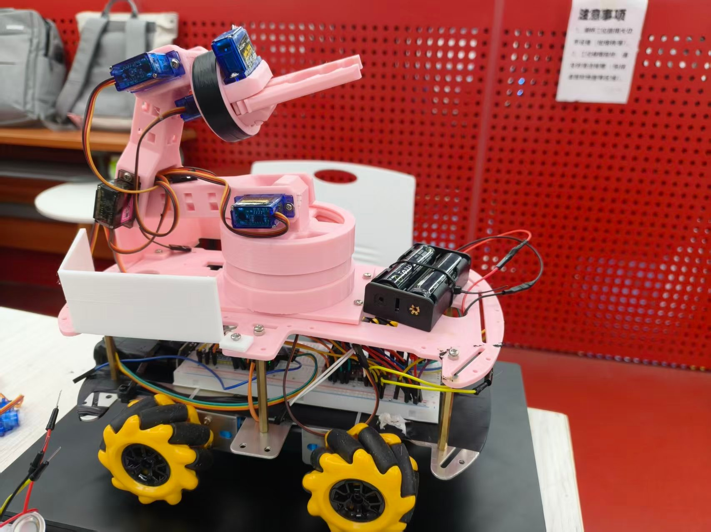
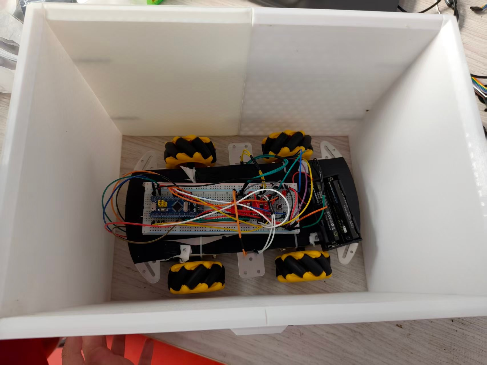
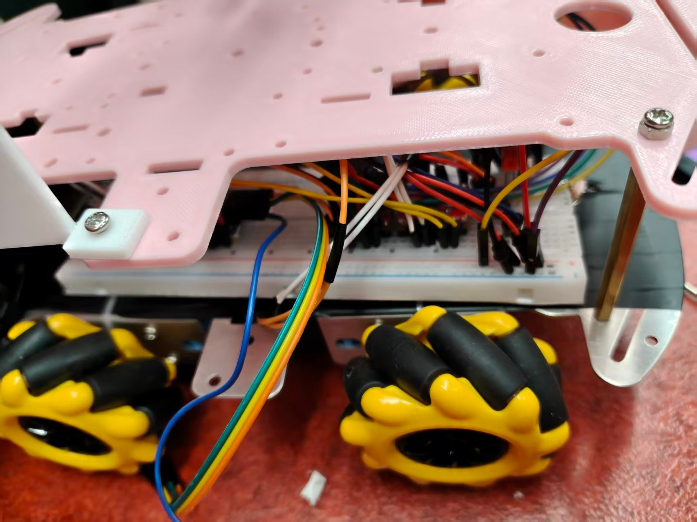
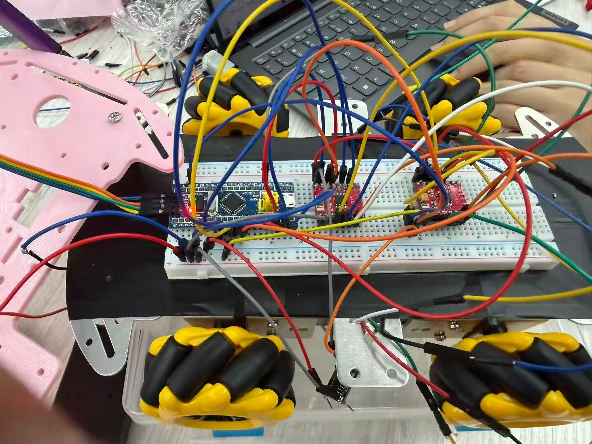
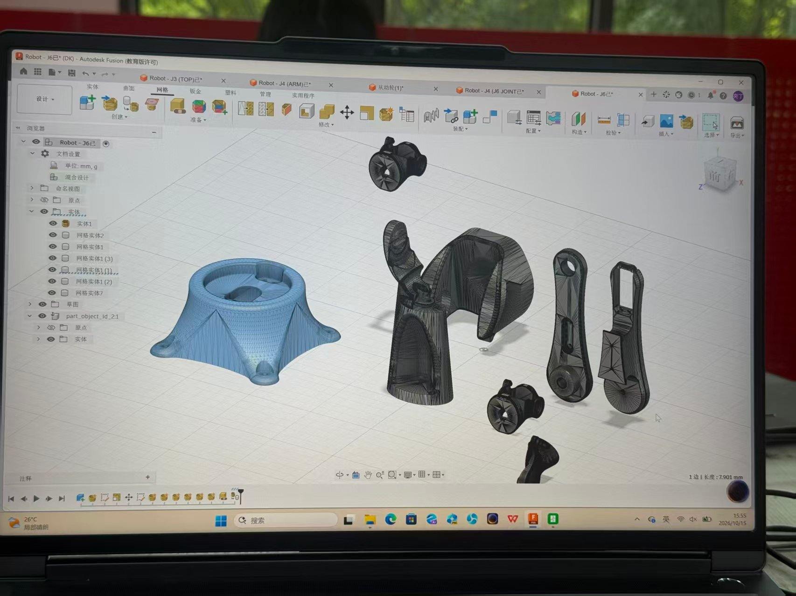
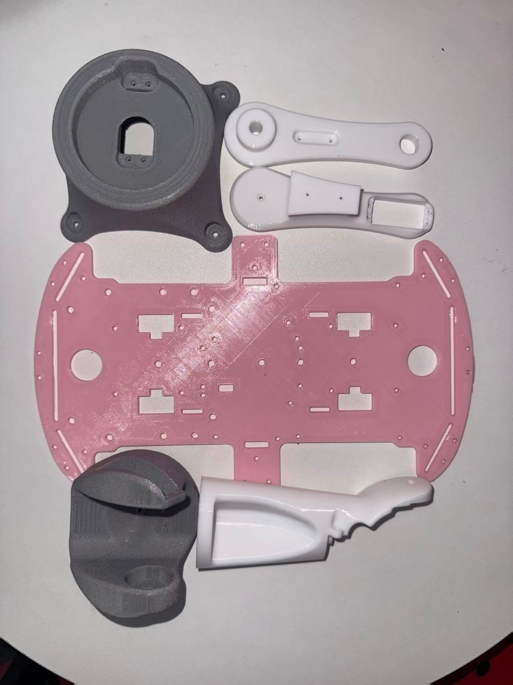
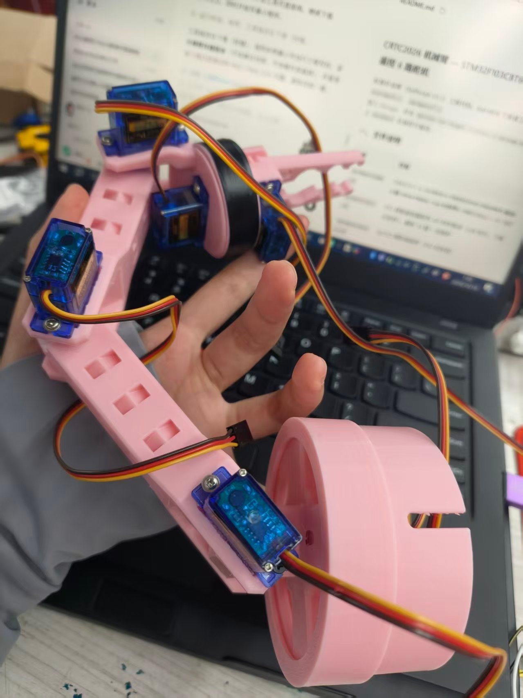

# 天山战队 · CRTC2026

> **中期考核技术文档**（按功能板块组织）
2026 重庆大学机器人训练大赛 · 新生组
2026.10.01 — 2026.10.19

| 战队 | 天山战队 |
| --- | --- |
| 队长 | 毛诗棋 |
| 记录周期 | 2026 年 10 月 1 日 — 10 月 19 日 |

*外形结构 · 电机驱动 · 麦轮全向 · 6×SG90 机械抓夹 · PS2 遥控*
*战队：天山战队*
*队长 / 财务：毛诗棋*
*成员：李霞（电控程序、电机驱动、麦轮运动学）、丁奕然（硬件接线、供电、PS2 与舵机调试）、潘美好（机械设计与装配、3D 打印、舵机装配调试）、刘迎奥（后台，Fusion 360 零件建模）*
*记录周期：2026 年 10 月 1 日 — 10 月 19 日*

## 写在前面

我们五人皆为大一新生，参赛之前，无一人系统修过单片机。真正把队伍扶上正轨的，无非几桩事：学长在队内讲授的那几场电控培训、陵龙战队承办的机械与硬件培训、B 站 keysking 的入门课程，再加上实验室里队友手把手现场点拨的工夫。余下的重头戏，大半倚仗 AI——把报错的截图甩过去，请模型指一条路，再自己上板去试。

*图 1　晚上在实验室对图纸和接线，桌上是刚到货的元件*
这份文档无意把过程描摹得比现实更顺畅。凡是写着"没弄明白""照着改的""试了三次才通"之处，皆为大实话——我们确是这般一步一磕走过来的。至于标注"验证过"的，则无一例外上过板、录过像。
依手册之规定，文档按功能板块分章，每节之内再循时间先后铺陈。**四份个人日志**（毛诗棋、李霞、潘美好、丁奕然各一份）与**一份按技术线组织的团队日志**，同存于本仓库 `docs/` 目录：

| 文件 | 视角 |
|---|---|
| `02-中期考核日志.md` | **维度视角**——按机械硬件 / 电控两条技术线展开 |
| `03~06-成员日志-*.md` | **人的视角**——每人 19 天的学习、踩坑与反思 |

> 刘迎奥负责后台建模（学习 Fusion 360、前期试建部分零件），未形成可装配模型，故未单独撰写日志。
整车落成之态：四轮麦克纳姆底盘，四个金属壳 TT 马达由两块 DRV8833 驱动，前端一套 6 个 SG90 拼成的机械抓夹（早期试过 MG995 / MG90S，因价格与灵活性更换为 SG90，详见第四节），PS2 手柄同时调度底盘与抓夹，能攥起 30mm 能量块，载着它走完整段赛程。



## 整车外形与结构

**10.1 定框架。手册钉死了三个数：初始 290×195×210mm、展开 445×400×450mm、总重 2kg。这三道尺寸，几乎把底盘的形制焊死了。当日会上拍定四轮对称布局：中部替电池与驱动板留槽，前段给抓取机构腾地——机构没定型之前，一个孔都不打。事后回看，这条铁律救了场，只因机构方案前后换了六版。**
**10.8—10.10 装配成形。潘美好将 TT 马达、底盘板、联轴器与四个麦轮拼出雏形。装配途中两处返工：**
①麦轮须呈 X 型排布，对角线上滚子朝向一致。头一遍装毕置地一推，车却朝斜里窜，只得拆散重来。验法极朴素——推一把，看它走不走直线。
②TT 马达的安装耳单薄，只锁一颗螺钉便晃。于内侧垫一片，把受力面撑实，晃荡方止。

*图 2　10.8—10.10 的底盘雏形：金属板 + 面包板 + 四轮麦轮，前端的机构空间还空着*
**10.18 三处改动，皆是被实情逼出来的，而非设计时便预见：**
①底盘底面整片缠上电工胶带。起因颇为偶然：金属板试车两日便刮花，有一回车停在了微倾的地面上，竟自己往下滑。缠妥之后，防滑、防刮一并解决，顺带把金属板与电池间的绝缘也做了，一卷胶带不过几块钱。
②顶部金属压线盘换作 2mm 塑料板。称重时才发觉，它只起个固定之效，分量却与电池不相上下；换掉之后整车轻了 40 多克。2kg 是一条硬杠，几十克亦是余量。
③塑料壳 TT 马达全数换成金属壳，缘由见第二节。

*图 3　10.18 硬件升级：粉色 3D 打印顶板装上车身，板的孔位是按舵机和走线重新排的*
改毕，尺寸仍游刃于限值之内，重量亦留得余量。外形展示与尺寸实测，皆已录入视频。



## 电机驱动与供电

**10.2 先弄清 DRV8833。丁奕然起初以为单片机引脚能直带电机，琢磨良久"一个引脚怎推得动马达"。问过 AI、又翻了手册，方才转过弯：单片机吐出的是 3.3V、几毫安的逻辑信号，真正出力的，是芯片内 H 桥，7.4V、几百毫安。**
**选型时做过一回比对。培训所发例程照 TB6612 写就，每路三个脚（IN1、IN2、EN）；手头这块 DRV8833 每路却只两脚，调速须往其中一只脚上打 PWM。两片真值表亦相左：TB6612 的 11 是刹车、00 是停，DRV8833 恰反过来。结论是那套代码不能照搬，10.4 便将此情告知电控组，好过等整车装毕才撞见。**
**10.11 供电链路。2S 电池 7.4V 分作两路：一路直入 DRV8833 的 VM 推电机，一路经降压模块落到 5V 供主控与舵机。所有模块共地。此处曾栽一坑：起初把电机动力线也压在面包板上，电机一转，面包板局部发烫，驱动输入由 7.9V 跌至 6.5V。后改动力线直连 VM、面包板只跑逻辑线，毛病遂消。面包板扛不住电机电流——这条，是烧过才记牢的。**





*图 4　供电链路实拍：电池盒在车尾，动力线与逻辑线分开走*

*图 5　底盘侧面的走线：动力线直接进驱动板，信号线经面包板，用扎带固定*

*图 6　供电接线白板示意图：红线 7.4V、粉红 5V、黑色地线，两块 DRV8833 的 STBY 统一拉高*
**10.18 换马达。塑料壳 TT 马达用了数日，毛病昭然：齿轮旷量大、壳体富弹性，手捏输出轴便能捏停；堵转之际，抖的是壳而非轮在推。换作同减速比（1:90）的金属壳后，刚性、扭矩一并上来。拆下的塑料壳未弃，留作备件——赛场烧一只马达，本非稀奇事。**
**电源稳定性。3 路舵机时曾现一次主控复位，添 470μF 电容化解。扩至 6 路，此象复现——这一回是六舵机同时堵转，瞬时电流翻番。末了再加第二颗电容，并将舵机供电与主控供电分线而走。此问题在第五节还会再提一笔，因它一头牵电控、一头挂机械。**

## 底盘全向移动

**10.7—10.8 方向表和代码分层。麦克纳姆轮借轮缘 45° 滚子，把力拆往两个方向；四轮协同，能横移、能原地打转。先绘出七种动作的方向表，再落到代码里。**
**落地的当口，撞上一桩绕不开的事：B、C 两个电机是反装的。车体左右对称，右侧那只须反向固定，故代码里写"正转"，B、C 实际转向却与 A、C 相背。**
首版于每种动作内单独处置，写了二十几个 if；改一处动作要动好几处，改到第三回便改乱了。次版换了思路：将"此轮该正转"与"此脚该出何电平"拆开，硬件差异收进四个宏，上层只管填正负。
    ```c
    #define B_DIR_FWD  0    // 反装，正转电平与 A、C 相反```
表面看只是齐整了些，10.10 那个 bug，全仗"能单独改一处电平逻辑"才敢去试。

*图 7　X 型布局俯视：对角线上滚子方向一致，面包板上临时搭的驱动电路*
**10.12—10.13 从查表到连续控制（李霞）。方向表只做得固定动作，摇杆要的却是连续速度。做法是把摇杆拆作 vx（左右）、vy（前后）、w（旋转）三量，按麦轮运动学合到四个轮上：**

| 轮子 | 速度 |
| --- | --- |
| 左前 A | vy + vx + w |
| 右前 B | vy − vx − w |
| 左后 C | vy − vx + w |
| 右后 D | vy + vx − w |

**公式乃查资料所得，不难。难在两端。输入侧：摇杆回的是 0~255，实测中心不在 128，而在 122，上限 250、下限 20，两边还不对称。按 ±128 归一化，结果是轻推即窜、推到半程反没了响应。后改依每轴实测的中心与极限做分段映射，方推得顺手。输出侧：斜推时某一轮速会顶破 PWM 上限被削，车便走歪。改法是合成后先觅绝对值最大者，超了便整体等比缩放。**
**10.9—10.10 上电乱转。这是整项里最磨人的一关，前后耗了三天半：烧录毕，每次上电，B、C 两轮自顾满速转，A、C 纹丝不动，须按一下键才归位。**
排查过程比结论更值钱，记于此：
①先疑切换瞬间的瞬态，排掉——现象是持续的，非闪一下。
②查软件：PWM 极性、定时器通道、GPIO 复用，逐项过，皆正常。
③做互换实验：把 B 的驱动模块与 A 对调，结果仍是 B 那位转。此步将范围由"模块坏了"缩到"随引脚与代码走"。
**④回初始化代码逐行读，找着了：上电时调过一次"停止"，而彼时停止用的是刹车停——四方向脚全拉高、PWM 给满。于 A、C 是刹车锁死；于反装的 B、C，方向脚为高恰是反转电平，再配满占空比，它们不是停住，是满速反转。**
根由是"刹车停"与"反装轮"两件各自无误的事撞到了一处。改法是将停止换作滑行停（方向脚拉低、PWM 清零），初始化中显式拉低所有方向脚、清零占空比，不倚赖任何默认状态。
**代价也有：滑行停刹不住，松杆后车还要往前溜一段。后来松杆时先给 100ms、20% 的反向小占空比压速，再切回滑行停。没有哪个改法是白赚的，只能挑代价吃得下的那一手。**

## 6×SG90 机械抓夹

**10.9 六版方案怎么筛出来的。黄块在赛场现身的位置有三：挂在物资架上（离地 250mm）、塞进洞穴里（70×70×50mm 开口）、搁在 70mm 高台上。一套机构要同时够着这三处，还得贴合规则中"携带"的定义——方块在重力作用下沿任意方向随车而行。**
六版方案与被否的原因：

| 方案 | 能解决 | 为什么否 |
| --- | --- | --- |
| 铲斗 | 地上方块，极简可靠 | 够不到物资架，钻不进洞 |
| 叉车叉子 | 洞穴 | 悬空高处够不着；方块是"放"着的，急转弯会掉 |
| 钩子 | 把架上的黄块拽下来 | 拽下来还是掉地上，等于多一道工序 |
| 八爪鱼 | 抓取最稳，通用性最好 | 至少 4 个舵机加复杂连杆，2kg 撑不住 |
| 机械臂 + 铲斗 | 高处和底面承托都覆盖 | 两套机构串一起，重量叠加，末端力臂太长带不动 |
| **机械抓夹（6×SG90）** | 一套机构覆盖三种场景 | 采用 |

定它的三条理由：
①夹持胜于承托。规则要求方块随车运动途中不被甩脱，夹住最稳，而"放"在铲面上急转便掉。
②SG90 价廉、体小，允以数量换自由度。6 个 SG90 的价钱尚不及一只 MG995，拼出的自由度却多得多；坏一只换一只，几块钱。
③距提交只剩十天，零件愈少愈易收尾。

### 舵机型号的选型对比

| 型号 | 单价 | 扭矩 | 重量 | 6 个合计 | 结论 |
|---|---|---|---|---|---|
| **SG90** | 约 ¥5~8 | 1.8 kg·cm | 9 g | **约 ¥40** | ✅ **采用** |
| MG90S | 约 ¥19 | 2.2 kg·cm | 13.4 g | 约 ¥115 | 扭矩仅高 22%，价格翻近 3 倍 |
| MG995 | 约 ¥25~35 | 10 kg·cm | 55 g | 约 ¥180 + 330 g | 扭矩过剩，**重量就吃掉 1/6 的 2kg 配额** |

**为什么不用大力矩舵机**：2kg 是一条硬杠。6 只 MG995 光是舵机就 330 g，加上金属齿与更大结构，机械臂大概率超重；而抓夹要提的只是一个 30mm、几十克的能量块——**扭矩不是瓶颈，重量才是**。

**SG90 的三个优势**：便宜（坏了换一只几块钱）、轻（6 只才 54 g）、小（能塞进 35mm 行程的紧凑结构）。

**代价**：SG90 内部电位器精度有限，**六只实测中位偏差横跨 3°~12°**，无法用统一值，只能逐路记偏置（见后文）。这是"以数量换自由度"必须付的账。
**10.16—10.18 做出来。机构早期由刘迎奥以 Fusion 360 试建过一部分零件，其后未续并入整机，最终定稿的模型由潘美好重画。六个舵机的分工：根部旋转、抬升、俯仰、腕部微调各一，末端两指开合占二。**



*图 8　装配前的 Fusion 渲染：各关节零件与舵机槽位，孔径按 0.3mm 放大后的版本*
制造上立了三条标准，皆是被前番失败逼出来的：
①舵机安装孔单边放大 0.3mm。早先按标称尺寸画孔，打印出来舵机塞不进，硬塞把件撑裂，整套报废重打。培训里学长讲过"孔径要放大 0.1~0.2mm"，我未落实，此番才记牢。
②开合行程须覆盖 30mm 方块并留 5mm 余量，即至少 35mm。
③连杆做镂空、减重。方块本不重，无需厚结构；减重之余，也压低了舵机的扭矩诉求。
**流程也调了：先打关键受力件试配，确认了再打全车件。如此即便失利，折损不过一两个小件，而非一整套。**



*图 9　第一轮打印件：不同配色的试配件与正式件混排，孔径按 0.3mm 放大后才能装进舵机*
**舵机装配与调试（潘美好 + 毛诗棋）。零件出齐后两人分了工：潘美好管机构装配与调整，毛诗棋管代码侧的通道与脉宽。**



装配上，SG90 的耳朵是极薄的塑料，螺钉拧紧会裂、拧松会晃。做法是先以 2mm 钻头把孔扩一扩、摆正，螺钉拧到"刚好压住不压变形"，底部点一点热熔胶辅助固定——热熔胶日后能掰下，不似 502 拆一回毁一只。

*图 10　抓夹机构第一次整机装配：六路舵机的线还比较乱*

*图 11　六个 SG90 装上打印臂，线序还没有理，中位偏置待标定*
**调试初遇的第一桩是中位不一致。代码给同样的 1500 脉宽，六个舵机装上后有的起手便偏一边。用量角器量，中位偏差自 3° 至 12° 皆有，差得最狠的那一路装上明显歪。这等事没法靠"统一一个值"了结，末了给每路单记一偏置量，装到结构上再微调。**
**第二桩是找堵转。一路路用手推夹爪，听声、摸壳温，发现有两路开到最大会"卡一下"且发热——机构在两指张开的极限位撞上了连杆的倒角。锉刀修掉倒角，干涉遂无。这步做完，毛诗棋才敢将夹持脉宽上限放开到 2300。**
### 6 路 PWM 通道的两次选型

**第一版设想**：TIM2（CH1~CH3）+ TIM3（CH1~CH3）。

理由是当时只接了 3 路舵机——丁奕然在引脚复用表上查到 PA0/PA1/PA2 恰是 TIM2 的 CH1/CH2/CH3，够用，就直接用了。

**为什么改**：舵机从 3 路扩到 6 路时，原方案暴露出两个问题：

| 问题 | 说明 |
|---|---|
| **占用定时器过多** | TIM2 与 TIM3 全部通道被占，而这两个定时器还要驱动 4 路电机（M1~M4 的 PWM 就在 TIM2/TIM3 上）——**舵机与电机抢同一个定时器，ARR 无法同时满足 50Hz 与 20kHz** |
| **一个计数 ≠ 1μs** | 电机 PWM 要 ARR≈3600（20kHz），舵机要 ARR=19999（50Hz）。同一定时器只能设一个 ARR |

**最终方案**：**TIM1（CH1~CH4）+ TIM4（CH1~CH2）**

| 定时器 | 类型 | 通道 | 用途 |
|---|---|---|---|
| **TIM1** | **高级定时器** | CH1~CH4 | 舵机 S1~S4（PA8/PA9/PA10/PA11） |
| **TIM4** | 通用定时器 | CH1~CH2 | 舵机 S5~S6（PB6/PB7） |
| TIM2 | 通用定时器 | CH1、CH3 | 电机 M1、M2 的 PWM（20kHz） |
| TIM3 | 通用定时器 | CH1、CH3 | 电机 M3、M4 的 PWM（20kHz） |

**这样分的三个好处**：

1. **舵机与电机彻底分开**——两组定时器各自的 ARR 独立，50Hz 与 20kHz 不打架
2. **舵机得到 1μs 分辨率**——预分频后 1 个计数正好 1μs，脉宽直接写微秒数，不用换算
3. **TIM1 一次给出 4 路**——4 个舵机共用同一个 50Hz 时基，相位天然同步

> ⚠️ **踩过的坑**：TIM1 是**高级定时器**，初始化后必须额外调用 `__HAL_TIM_MOE_ENABLE()` 才有波形输出。这一句漏掉时，寄存器全部配置正确、示波器却没有信号，查了很久。TIM4 是通用定时器，不需要这一句。

对外只留一个接口：
    ```cvoid Servo_SetPulse(uint8_t ch, uint16_t pulse)  // 内部限幅 1000~2000（试 500~2500 时烧过 1 只舵机）```
限幅压在最底层，是因超程会把舵机顶到物理限位，堵转很快便烧线圈。10.12 试过一回 3000，舵机"咔咔"抖了几秒，外壳摸着发烫，此后无人敢试第二回。
**10.19 验证。方块携带、连续过弯、180mm 落体无掉件、6 路动作后停在非初始位保持静止，皆过，录了像。**
**录制前出过一回返工：夹住方块一转弯便滑。头一反应是夹力不足、想换大舵机，蹲下对着细看，才发觉夹爪内侧橡胶垫贴歪了，只贴住半边面积。重贴之后连过三弯未掉。这回忍住没换件是对的——先把现象看准，比先动手改省钱省时间。**

## PS2 手柄遥控

**10.5—10.10 硬件侧（丁奕然）。先摸清四根线：DAT、CMD、CS、CLK。随后撞上一堆无说明书的难题：**
①手柄开机红绿灯齐闪，查过才知是在搜接收器、尝试配对，并非坏了。
**②接收器上标着 RX 的那颗绿灯，手柄彻底关机也常亮。起初当是"配对成功"，乐了半日，结果串口一个字节都读不到。翌日把几块板摆一处比，又找来别人的实物图，方确认是丝印标错了位置，那颗绿灯只是电源灯。**
那之后立了规矩：不看灯，只认串口读回的字节。第 3 个字节是 `0x5A` 才算真通。
③复位配对有严苛次序：按住小孔里的同步键、上电、再开手柄。三步错一便同步不上。首回落败，只因按的时长不够。
引脚规划改过一版。白板上最早按 SPI2 的四个脚规划（DAT→PB12、CMD→PB13、CS→PB14、CLK→PB15，见下图），后来发现培训例程全是 SPI1 的，而 PA4/PA5/PB5 恰好是 SPI1 的 NSS/SCK/MOSI，直接挪过来能少改代码，最终定成 DAT→PA4、CMD→PA5、CS→PB3、CLK→PB5，写进共享文档，电控与硬件皆能查。

*图 12　10.8 的引脚规划白板：初版按 SPI2 规划，两块 DRV8833 占 PA1~PA8，蓝线普通信号、橙线舵机 PWM*
**10.13—10.15 软件侧（毛诗棋）。**

**通信方式的选型**：PS2 协议本质是「SPI 类」时序，但**本队最终采用 GPIO 位操作（软件模拟）而非硬件 SPI 外设**。

| 方案 | 优点 | 缺点 | 是否采用 |
|---|---|---|---|
| **硬件 SPI1 外设** | 时钟由外设产生，不占 CPU | PS2 的 ATT 帧间隔、逐位建立/保持时间与标准 SPI 不完全兼容；配错时只能整体改配置，看不到单根线的波形 | ❌ 未采用 |
| **GPIO 位操作（软件模拟）** | **每一根线的电平与延时都能精确控制**；调试时可直接用逻辑分析仪抓单根线；改时序只需改几行延时 | 占 CPU，需手写位操作 | ✅ **采用** |

**为什么选后者**：PS2 接收器没有公开的完整时序手册，参数全靠试。硬件 SPI 一旦配错只能盲猜，而位操作可以把「拉低 ATT → 发一位 → 收一位 → 拉高 ATT」拆成可观察的每一步。**后来「DATA/CMD 接反」与「只发一帧导致回包错位两位」这两个坑，都是靠着能单独控制每一根线才查出来的。**

**实现要点**：9 字节一帧（`0x01 0x42 0x00…`），ATT 拉低开始、拉高结束，CLK 由软件翻转。

## 踩的坑
①DATA 与 CMD 接反，读回全是 0。
②只发一帧，回包整体错位两位，读到的键值永远对不上。
③手柄按键低电平有效，读出须取反方是"按下"。
摇杆值处理分三步：去中心（减实测的 122）、死区（±8，太小会抖、太大会迟钝）、分段映射（推杆行程不对称，上下半程分别算）。再添迟滞——目标值与前值差过 10μs 方更新，抖动乃消。
**10.15—10.18 联调。按"信号先行、动力后上"做了三轮。中途发觉，手柄控底盘的同时若有舵机动作，底盘速度便一顿一顿，根由在主循环里嵌了阻塞延时。把舵机更新从主循环挪到定时器中断后，毛病遂无。**

## 开发环境与学习方式

**工具链。国庆那几日并行试了 Keil MDK、STM32CubeIDE、VSCode（EIDE 插件） 三套，各自跑通一个空工程。末了主用 Keil，缘由很实在：培训发的例程皆是 Keil 工程，队友间直接给工程文件即可，不用来回转格式；CubeIDE 备用；VSCode 用来看代码、写笔记。**
**学习方式。队里底子都薄，无谁先把 STM32 学通再动手。技术来源主要有三条：**
**①统一培训。学长在队内讲的电控培训，陵龙战队承办的机械与硬件培训，讲及 GPIO/PWM、电机驱动、供电与装配规范。这是我们能从零到动手的根基，也是唯一有师长在场、可当场发问的时机。**
**②公开课。国庆间队里看了 B 站 keysking 的单片机入门系列，毛诗棋另看了黑马程序员的 C 语言课。这几门课的作用，是把"引脚、PWM、定时器"这些词与实物对上号；看完不等于会，但至少听培训时不再如听天书。**
**③问学长学姐。这一条用得其实比想中更多：队里的学长、陵龙战队的学长学姐基本随问随答，从"这个引脚为何要上拉"到"这个结构一般怎么固定"皆问过。许多卡我们半日的问题，学长瞥一眼便点出——譬如共地的关窍，就是学长顺口一句点醒的。新手组最大的便利正在此处，不必不好意思。**
**④AI 辅助。这也是占比甚大的一块，如实写在这里。遇着配不出的参数、看不懂的报错、不知接哪根线，第一反应是把截图与现象甩给 AI。试工具链那几日，还会把同一报错分别丢给几个不同模型，看谁给的排查方向对路。**
**用 AI 的效果很分裂。好的一面是快——原本要翻半日手册的配置，几句话便知点哪；坏的一面是"会用不等于会"，离了 AI 我们常讲不清为何这样配。故后来立下规矩：AI 给的东西一律上板验，跑不通便不算数。10.11 那个时钟树的问题便是例证，AI 提过"先检查时钟树"，我们未当回事，白白走了两天。**
文档里标"验证过"处皆上过板；只是照着配出的，我们未写成学会了。
这期间还立下两条规矩，皆吃亏后才立：
①自定义代码一律写进 `USER CODE` 区之间，或单独开 `.c/.h`。有一回改引脚配置重新生成，两百多行手写代码被冲掉，从备份里捞回。
②工程保持唯一真源。机器上曾有两个同名目录，"改了 A、烧了 B"，对着屏幕困惑了十余分钟。

## 第三方资料使用声明

**我们未使用 GitHub 上的开源代码项目。**机械抓夹的爪架部分使用了一个来自 MakerWorld 平台的开源 3D 模型**，直接导入切片软件切片打印后装机，未对模型几何做修改；其余结构件由本队自行建模。机械抓夹的机构参考，源自潘美好在网上检索到的机械臂 / 夹爪实物图片（页面截图与作者展示的成品图见下），属看图参考性质，不存在需遵守的开源协议或模型授权问题。**
**参考图只作定"大概长什么样、几个关节、舵机装在哪"的依据。建模上，刘迎奥前期用 Fusion 360 试过一部分零件，未形成可供装配的整套模型；臂部连杆、底座圈与顶板由潘美好在 Fusion 360 里自行建模；**爪架部分则取自 MakerWorld 平台的开源模型，直接切片打印**（详见《开源与第三方资料声明》）。，依本队 30mm 能量块的抓取需求改了三处：连杆长度与臂展、舵机安装孔公差（单边放大 0.3mm）、末端夹指开合行程（放大到 35mm 以上）。切片参数与装配工艺皆由我们自调。**

*图 13　潘美好检索到的机构参考图之一：多关节机械臂的模型页面*

*图 14　参考图之二：同类机构装上 SG90 后的成品实物，我们据此确定舵机布局*
① 爪架模型：**MakerWorld 平台开源 3D 模型**，直接导入切片软件打印，未改几何；许可证见《开源与第三方资料声明》
② 参考图片：网络公开图片，仅作外观与布局参考
③ 代码部分：全部为本队自行编写（HAL 库由 STM32CubeMX 官方工具生成，属官方免费工具链），未复制任何第三方开源项目代码
④ 其余建模与制造：Fusion 360 自行建模，切片打印与装配为本队完成

## 财务与采购

**负责人：毛诗棋。从 10.2 定采购单开始，队里的钱一直是我在管。**
**预算与核价。以手册附录的物资表为准，逐项核价，合计 353.48 元。学校统一采购额度有限，我们在这框架里做减法：能回收的（底盘板、联轴器）先向战队要，一次性的（耗材、杜邦线）自购。**
**冗余取舍。下单前与硬件组对过一遍，他们提了个我没想到的点：DRV8833 一块能带两个 TT 马达，四轮理论上两块便够，但建议备两块——两块钱一个，烧了不心疼，省下的时间比省下的钱值钱。我采纳了。SG90 同理，6 个够用，备了 2 个。**
**支出记录。实际下单部分合计实付 ¥106.10（TT 马达 ¥22、18650 电池 ¥22.99、电烙铁 ¥37.94、MG90S 舵机 ¥19.33、螺丝批套装 ¥3.84），另有底盘板、联轴器等是从战队垃圾箱里翻出来回收利用的旧件，未花分文。完整订单明细与截图见仓库 `采购清单.md`。**

*图 15　TT 马达订单：全金属齿轮 1:90，×4 实付 ¥22（毛诗棋 截图）*

*图 16　18650 电池 ¥22.99 与德力西 60W 数显调温电烙铁 ¥37.94 的订单（毛诗棋 截图）*

*图 17　整车在实验室：此时还是塑料壳马达与面包板临时电路（丁奕然 摄）*
**预算和实际差这么多的原因。353.48 元是按"全新采购"核的上限价；实际执行时，能回收的从战队垃圾箱里捡、能借的借，工具类买一次往后一直能用，故实付压到三分之一上下。驱动板、主控、降压模块这些大头是从实验室领的，未进这张订单，清单里已注明。**
**超支的处理。10.17 换金属壳 TT 马达属计划外支出，钱从耗材预算里挪，同时把顶板换塑料板压了重量——钱与重量都得算，这是这半个月学来的东西。**

## 演示办法索引

按手册 4.1 的指标逐条对应：
①外形展示：绕车一周视频。
②电机运动（全部）：四轮正反转。
③舵机运动（多项）：6 路依次动作，最后停在非初始位置保持静止 5 秒。
④底盘运动（全部）：PS2 手柄与车体同框，演示前后、横移、旋转。
⑤尺寸规范：直尺实测长宽高，数字拍近景。
⑥方块携带（单一 / 多项）：地面抓取、携带移动；保持一个的同时再抓第二个。
⑦结构稳定性：直尺量 180mm，底面朝下自由落体。
⑧规划 / 现有采购单：见仓库 `采购清单.md`，含 353.48 元物资表核价与冗余件取舍。
⑨全程演示：从起点抓起能量块，带着走完全程，中途不落地——这是"携带"能不能成立的关键一条，单独录一条完整的。
⑩每条视频开头报一句"天山战队，第 X 项，XXX"，时长控制在 20~40 秒，方便评审按指标定位。

## 成员与分工

| 成员 | 角色 | 中期阶段承担的工作 |
| --- | --- | --- |
| 毛诗棋 | 队长 / 财务 / 电控 | 总体方案与排期、采购与记账、舵机六路 PWM 与时序、整车联调、文档整合 |
| 李霞 | 电控程序 | 麦轮运动学解算、手柄帧解析、底盘闭环与调试 |
| 丁奕然 | 硬件接线与调试 | 供电链路、驱动板接线、引脚规划、共地与噪声排查、PS2 与舵机调试 |
| 潘美好 | 机械与硬件 | Fusion 360 建模、3D 打印与切片、抓夹装配调试、底盘装配 |
| 刘迎奥 | 机械 | 后台工作：学习 Fusion 360、参与部分零件建模 |

