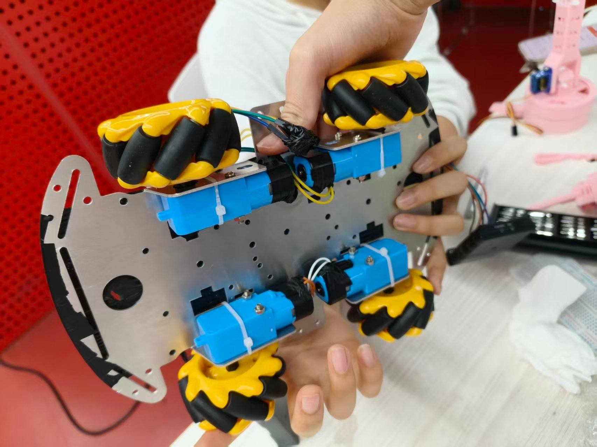
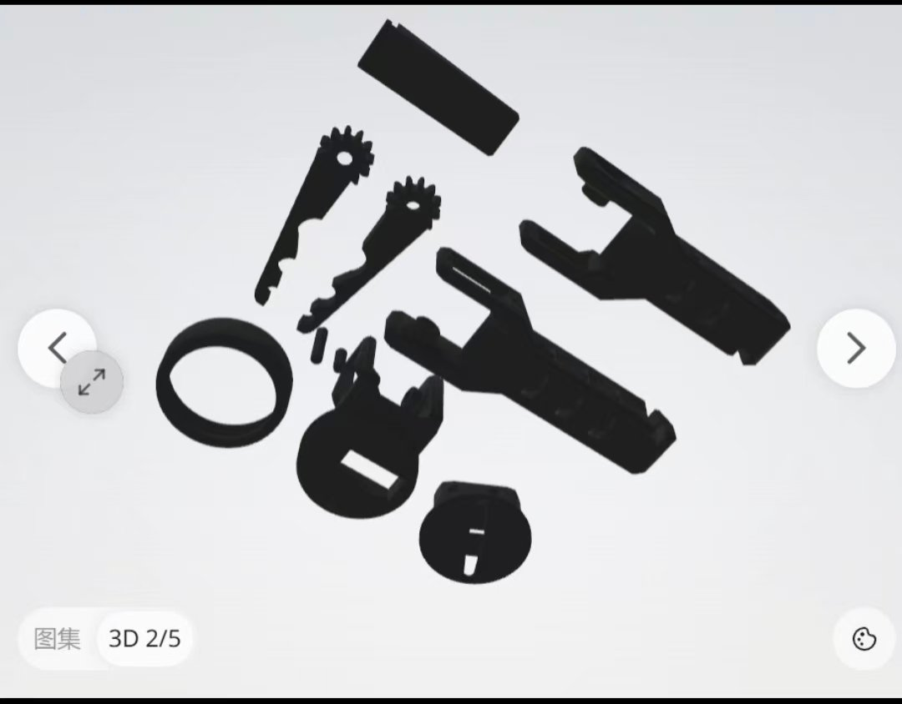
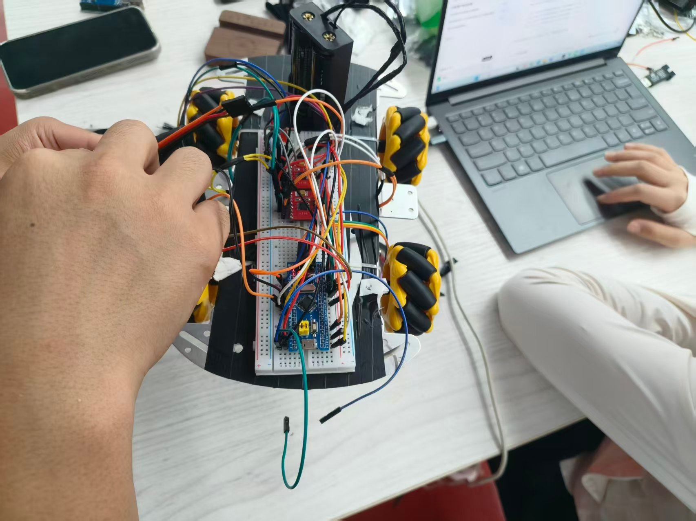
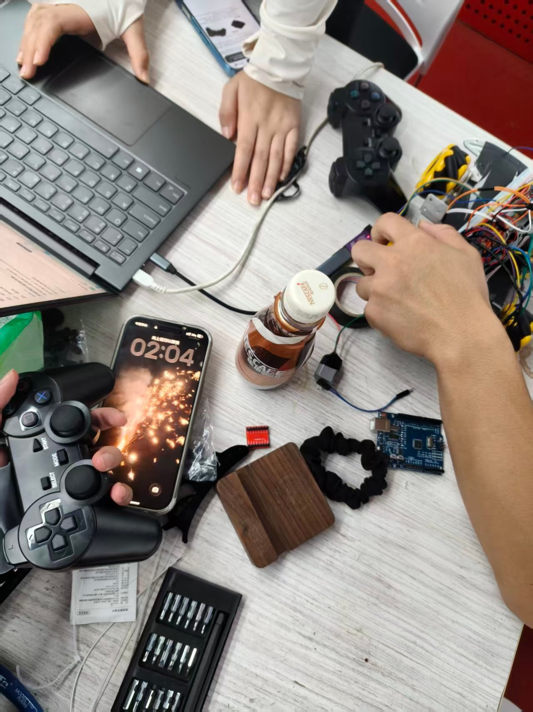
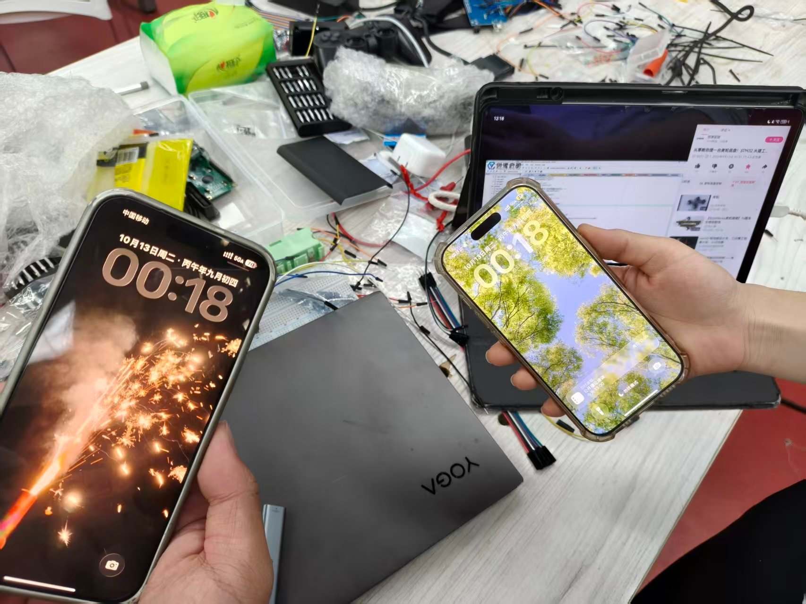

# 天山战队 · 中期考核开发日志

> **队伍**：天山战队　｜　**实训战队**：陵龙战队　｜　**组别**：新生组
> **队长**：毛诗棋
> **成员**：李霞、潘美好、丁奕然、刘迎奥
> **记录周期**：2026-10-01 — 2026-10-19
> **机器人**：TS-1（四轮麦轮底盘 + 6×SG90 机械抓夹 + PS2 遥控）

---

## 关于这份日志

按手册《文档规范》的要求，本文档**以机器人的单个功能为一个板块**，每个板块由「功能描述 + 开发历程」构成，板块之间**按设计进度的完成时间从早到晚**排列。

与四份《成员成长史》的区别在于：

| 文档 | 视角 | 回答的问题 |
|---|---|---|
| **本文件** | **维度视角**（机械硬件 / 电控） | 这个**功能**是怎么做出来的？两条技术线在哪几个点上互相牵制？ |
| 《成员成长史》×4 | **人的视角** | **我**这十九天学了什么、踩了什么坑、想通了什么？ |

**两条线交叉的地方，才是本项目真正的难点。** 单独看电控，舵机不过是一路 PWM；单独看机械，舵机不过是一颗螺钉。但「六路同时堵转把主控拉复位」这件事，只有两条线放在一起才说得清。故本文件第三章专列「交叉点」。

---

# 一、机械硬件线

## 1.1 底盘结构与装配

**功能定义**：承载全部电子件与抓取机构，在 290×195×210mm 的收纳体积内实现四轮全向移动。

### 时间线

| 日期 | 进展 | 负责人 |
|---|---|---|
| 10-01 | 依手册三道硬约束（初始 290×195×210 / 展开 445×400×450 / ≤2kg）拍定四轮对称布局 | 毛诗棋、潘美好 |
| 10-09 | 逐条拆解规则中的机械约束，定电机四角布局、前部预留 60×40mm 机构工位（孔位留空） | 潘美好 |
| 10-10 | 底盘实物装配成形：TT 马达 + 金属底盘板 + 联轴器 + 4×麦轮 | 潘美好 |



| 10-18 | 三处硬件升级（见下） | 潘美好、丁奕然 |

### 装配中的两次返工

**① 麦轮 X 型排布装反**

首轮装毕推车，车朝斜里窜。原因是四条麦轮的滚子朝向须呈 X 型——**对角线上两轮的滚子方向必须一致**。验法极朴素：把车推一把，看它走不走直线。

**② TT 马达安装耳单薄**

塑料壳 TT 马达的安装耳只锁一颗螺钉便晃。做法是在马达内侧垫一片，把受力面撑实。

### 10-18 三处升级：都是被实情逼出来的

| 改动 | 触发问题 | 决策依据 | 副作用 |
|---|---|---|---|
| **底盘底面缠电工胶带** | 金属板试车两日刮花；停在微倾地面会自己下滑 | 防滑 + 防刮 + 与电池绝缘，一卷几块钱 | 缠绕须沿同一方向压边，否则跑几趟就翘角 |
| **顶部金属压线盘 → 2mm 塑料板** | 称重发现这块板只起固定作用，克重却与电池相当 | 2kg 是硬杠，几十克也是余量 | 减重约 40g，刚性仍够 |
| **塑料壳 TT 马达 → 金属壳（1:90）** | 齿轮旷量大、壳体有弹性，手捏输出轴能捏停；堵转时是壳在抖而非轮在推 | 同减速比下刚性、扭矩一并提升 | 计划外支出，钱从耗材预算挪；拆下的塑料壳留作备件 |

> **口径说明**：这三项升级由**潘美好**主责（结构方案与实施），**丁奕然**从电气角度复核（换马达后的电流与压降、胶带的绝缘作用），在两人日志中分别从各自视角记录，不重复叙述。

---

## 1.2 供电链路与线束

**功能定义**：把 2S 电池的 7.4V 分成两条互不干扰的支路，并保证全系统共地。

### 最终拓扑

```
2S 18650 (7.4V)

   │
   ├──→ DRV8833 ×2 的 VM ──→ 4×TT 马达（动力支路，大电流）
   │
   └──→ 降压模块 ──→ 5V ──→ 6×SG90 舵机（每路并 470μF）
                     │
                     └──→ STM32 板载 3.3V ──→ 主控 + PS2 接收器
   │
   └────────── 所有 GND 熔为一处（共地）──────────┘
```

### 踩过的三个坑

| # | 现象 | 根因 | 解决 | 谁发现的 |
|---|---|---|---|---|
| 1 | 电机一转，面包板局部发烫，驱动输入从 7.9V 跌到 6.5V | 面包板簧片与细跳线扛不住电机启动浪涌 | 动力线改为电池直插 VM，面包板只跑逻辑线 | 潘美好 |
| 2 | 改线后有一台电机不转 | 该驱动板的 GND 未接入主地 | 万用表蜂鸣档逐根点测，确认全部 GND 连通 | 潘美好 |
| 3 | 3 路舵机时主控复位；扩到 6 路后复现 | 舵机同时堵转，瞬时电流翻番，5V 母线被拉塌 | 加第二颗电容 + 舵机供电与主控供电分线 | 丁奕然 |

**共同教训**：**面包板扛不住电机电流**——这条是烧过才记牢的。**共地不是"接上就行"，而是"每一段都要用蜂鸣档验过"。**

### 焊接与线束

- 电池盒引脚属难镀锡材质，烙铁温度不足挂不上锡 → 提高温度并先上助焊剂
- 首回焊罢未套热缩管，两线相触瞬时短路（未烧毁物件，但惊出冷汗）→ **此后所有焊点一律补热缩管**
- 动力线与信号线分道而行，尽量不平行贴附，用扎带固定

---

## 1.3 抓取机构：六版方案怎么筛出来的

**功能定义**：一套机构同时够着三处黄块位置（物资架 250mm / 洞穴 70×70×50mm / 高台 70mm），并满足规则中「携带」的定义——方块在重力作用下沿任意方向随车而行。

### 六版方案对比

| 方案 | 能解决 | 为什么否 |
|---|---|---|
| 铲斗 | 地上方块，极简可靠 | 够不到物资架，钻不进洞 |
| 叉车叉子 | 洞穴 | 悬空高处够不着；方块是「放」着的，急转弯会掉 |
| 钩子 | 把架上的黄块拽下来 | 拽下来还是掉地上，等于多一道工序 |
| 八爪鱼 | 抓取最稳，通用性最好 | 至少 4 个舵机加复杂连杆，2kg 撑不住 |
| 机械臂 + 铲斗 | 高处和底面承托都覆盖 | 两套机构串一起，重量叠加，末端力臂太长带不动 |
| **机械抓夹（6×SG90）** | **一套机构覆盖三种场景** | **采用** |

### 选它的三条理由

1. **夹持胜于承托**——规则要求方块随车运动途中不被甩脱，夹住最稳，而「放」在铲面上急转便掉
2. **SG90 价廉体小，允以数量换自由度**——6 个 SG90 的价钱尚不及一只 MG995，拼出的自由度却多得多；坏一只换一只，几块钱
3. **距提交只剩十天，零件愈少愈易收尾**

### 六路舵机的分工

| 舵机 | 关节 | 作用 |
|---|---|---|
| S1 | 根部旋转 | 整臂左右转，对准目标 |
| S2 | 抬升（肩） | 决定高度 |
| S3 | 俯仰（肘） | 决定伸出距离 |
| S4 | 腕部微调 | 对准方块角度 |
| S5、S6 | 末端两指开合 | 夹持 |

### 制造上立的三条标准（都被前番失败逼出来）

1. **舵机安装孔单边放大 0.3mm**——早先按标称尺寸画孔，打印出来舵机塞不进，硬塞把件撑裂，整套报废重打
2. **开合行程 ≥ 35mm**——须覆盖 30mm 方块并留 5mm 余量
3. **连杆镂空减重**——方块本不重，无需厚结构；减重之余也压低了舵机的扭矩诉求

### 流程也改了

**先打关键受力件试配，确认了再打全车件。** 如此即便失利，折损不过一两个小件，而非一整套。10-18 首度完整跑通：机械臂核心连杆悉数顺利出件，三个关节孔位一次性全对上。



---

## 1.4 硬件侧问题清单（丁奕然整理）

十九天踩过的坑凝成五类，**这份清单换一块板子仍堪沿用**：

| 类别 | 具体条目 |
|---|---|
| **丝印标注错误** | 以数据为准，不以标签为准 |
| **指示灯误导** | 接收器的「RX」绿灯只是电源灯，手柄关机也常亮，与配对无关 |
| **芯片差异** | DRV8833 与 TB6612 的引脚数、真值表、调速方式全不同，代码不能复用 |
| **共地** | 所有模块 GND 必须完全连通；动力地与逻辑地走线分开 |
| **舵机 PWM** | 50Hz、0.5~2.5ms、必须限幅、不能从 3.3V 引脚取电 |

### 上电前检查清单（每次联调前走一遍）

1. 万用表蜂鸣档测所有 GND 是否连通
2. 测 VM 与 VCC 有无接反
3. 测 5V 输出是否约 5.0V、3.3V 是否 3.3V
4. 确认无短路（红黑之间不通）
5. 确认所有舵机信号线皆插在 PWM 引脚上

### 分步调试次序（本次项目的核心方法论）

```
模块单独测试 → 信号接线 → 串口验证 → 接入电机动力
                                    ↑
                          最后才上动力电



```

> 一次性把线全接妥再上电，一旦不动，你面对的是二十几个潜在故障点，根本无从下手。

---

# 二、电控线

## 2.1 开发环境与工程规范

**功能定义**：建立一套"改了不会丢、烧了不会错"的开发流程。

### 工具链选型对比

国庆几日并行试了三套，各自跑通一个空工程：

| 工具 | 优点 | 缺点 | 结论 |
|---|---|---|---|
| **Keil MDK** | 培训例程全是 Keil 工程，队友间直接给工程文件即可 | 收费、界面陈旧 | **主用** |
| STM32CubeIDE | 免费、与 CubeMX 集成好 | 首次编译慢 | 备用 |
| VSCode + EIDE | 看代码、写笔记舒服 | 配置繁琐 | 辅助 |

**选 Keil 的理由很实在**：不用来回转格式。

### 两条吃亏后立下的规矩

1. **自定义代码一律写进 `USER CODE` 区之间，或单独开 `.c/.h`**
   有一回改引脚配置重新生成，两百多行手写代码被冲掉，从备份里捞回
2. **工程保持唯一真源**
   机器上曾有两个同名目录，"改了 A、烧了 B"，对着屏幕困惑了十余分钟

---

## 2.2 麦轮运动学与底盘控制（李霞）

**功能定义**：把 PS2 摇杆的连续输入，解算为四个轮子的速度指令。

### 从查表到连续控制

方向表只做得固定动作，摇杆要的却是连续速度。做法是把摇杆拆作 `vx`（左右）、`vy`（前后）、`w`（旋转）三量，按麦轮运动学合到四个轮上：

| 轮子 | 速度 |
|---|---|
| 左前 A | `vy + vx + w` |
| 右前 B | `vy − vx − w` |
| 左后 C | `vy − vx + w` |
| 右后 D | `vy + vx − w` |

### 两端的坑

**输入侧**：摇杆回的是 0~255，实测中心不在 128，而在 **122**，上限 250、下限 20，两边还不对称。按 ±128 归一化，结果是**轻推即窜、推到半程反没了响应**。后改依每轴实测的中心与极限做分段映射。

**输出侧**：斜推时某一轮速会顶破 PWM 上限被削，车便走歪。改法是合成后先觅绝对值最大者，超了便整体等比缩放。

### 代码分层：一个决定后续成败的重构

B、D 两个电机是**反装**的（车体左右对称，右侧须反向固定），故代码里写"正转"，B、C 实际转向却与 A、C 相背。

- **首版**：每种动作内单独处置，写了二十几个 `if`；改一处动作要动好几处，改到第三回便改乱了
- **次版**：将"此轮该正转"与"此脚该出何电平"拆开，硬件差异收进四个宏，上层只填正负

```c
#define B_DIR_FWD  0    // 反装，正转电平与 A、C 相反
```

> 表面看只是齐整了些，但 10-10 那个 bug，全仗"能单独改一处电平逻辑"才敢去试。

---

## 2.3 舵机 PWM 与机械臂控制（毛诗棋）

**功能定义**：六路 SG90 的统一驱动接口，输出稳定的 50Hz 舵机信号。

### 硬件通道规划

| 方案 | 通道 | 结论 |
|---|---|---|
| 初期设想 | TIM2（CH1~CH3）+ TIM3（CH1~CH3） | 可行但占两个定时器 |
| **最终** | **TIM1（CH1~CH4）+ TIM4（CH1~CH2）** | **一个高级定时器 + 一个通用定时器** |

**统一参数**：50Hz、预分频使 1 个计数对应 1μs、脉宽范围限幅。

### 对外只留一个接口

```c
void Servo_SetPulse(uint8_t ch, uint16_t pulse);  // 内部限幅 500~2500
```

**限幅压在最底层**，是因为超程会把舵机顶到物理限位，堵转很快便烧线圈。10-12 试过一回 3000，舵机"咔咔"抖了几秒，外壳摸着发烫，此后无人敢试第二回。

> ⚠️ **本次项目实际烧毁过 1 只 SG90**：调试时把脉宽推到 600/2400μs 想让动作更夸张，超出 SG90 的机械行程，舵机持续堵转、发热，最终烧毁。**此后脉宽一律限制在 1000~2000μs 的标准范围。**

### 中位标定：没法靠"统一一个值"了结

代码给同样的 1500 脉宽，六个舵机装上后有的起手便偏一边。用量角器量，**中位偏差自 3° 至 12° 皆有**。SG90 这等数元舵机，内部电位器精度本就如此。

**做法**：给每一路单独记一个中位偏置量，装到结构上再微调。

---

## 2.4 PS2 手柄通信

**功能定义**：把手柄的按键与摇杆，变成整车可用的控制指令。

### 硬件侧（丁奕然）

SPI 类协议，9 字节一帧。四根关键信号：

| 信号线 | 作用 | 方向 |
|---|---|---|
| DAT | 数据 | 双向 |
| CMD | 命令 | 主机 → 从机 |
| CS | 片选 | 主机 → 从机 |
| CLK | 时钟 | 主机 → 从机 |

### 引脚规划改过一版

> 注：引脚表中「SPI1 复用」一列仅说明芯片内部默认功能；**本队实际未启用 SPI1 外设**，四个脚均作普通 GPIO 使用。


| 版本 | DAT | CMD | CS | CLK | 变更原因 |
|---|---|---|---|---|---|
| 初版 | PB12 | PB13 | PB14 | PB15 | 按 SPI2 规划 |
| **最终** | **PA4** | **PA5** | **PB3** | **PB5** | 培训例程全是 SPI1，PA4/PA5 恰是 SPI1 的 NSS/SCK，挪过来能少改代码 |

### 三个无说明书的坑

1. **手柄开机红绿灯齐闪**——是在搜接收器、尝试配对，并非坏了
2. **接收器上标「RX」的绿灯**——手柄彻底关机也常亮。起初当是"配对成功"，乐了半日，结果串口一个字节都读不到。翌日把几块板摆一处比，方确认**丝印标错了，那颗绿灯只是电源灯**
3. **复位配对有严苛次序**——按住小孔里的同步键、上电、再开手柄，三步错一便同步不上

> **立下规矩：不看灯，只认串口读回的字节。第 3 个字节是 `0x5A` 才算真通。**

### 灯态对照表

| 灯的状态 | 含义 |
|---|---|
| 双灯快闪 | 正在搜索、尝试配对 |
| 红灯常亮 | 已进入模拟模式，可以开始调 |
| 绿灯常亮 | **仅电源指示，与配对无关** |
| 灯不亮 | 没供电或线断了 |

### 软件侧（毛诗棋）

**通信方式**：PS2 是「SPI 类」时序，但本队采用 **GPIO 位操作（软件模拟）**，而非硬件 SPI 外设。

| 方案 | 结论 |
|---|---|
| 硬件 SPI1 外设 | ❌ 未采用——ATT 帧间隔与逐位建立时间与标准 SPI 不完全兼容，配错时看不到单根线 |
| **GPIO 位操作** | ✅ **采用**——每根线的电平与延时都能精确控制，方便用逻辑分析仪逐线排查 |

**为什么这么选**：PS2 接收器没有公开时序手册，参数全靠试；位操作把「拉低 ATT → 发一位 → 收一位 → 拉高 ATT」拆成可观察的每一步。「DATA/CMD 接反」「只发一帧导致回包错位」这两个坑，都是靠逐线控制才查出来的。

9 字节一帧（`0x01 0x42 0x00…`），ATT 拉低开始、拉高结束，CLK 由软件翻转。

**踩的坑**：

1. DATA 与 CMD 接反，读回全是 0
2. 只发一帧，回包整体错位两位，读到的键值永远对不上
3. 手柄按键**低电平有效**，读出须取反方是"按下"

**摇杆值处理三步**：去中心（减实测的 122）→ 死区（±8，太小会抖、太大会迟钝）→ 分段映射（推杆行程不对称，上下半程分别算）。再添**迟滞**——目标值与前值差过 10μs 方更新，抖动乃消。

---

## 2.5 整车联调与验收

**功能定义**：让手柄同时驭使底盘与机械臂，不互相拖累。

### 联调三轮（信号先行、动力后上）

```
第 1 轮：只接信号，验证手柄数据能否正确传入程序
第 2 轮：单独驱每台电机，确认方向
第 3 轮：四轮齐动 + 六路舵机
```

**中途发现的问题**：手柄控底盘的同时若有舵机动作，**底盘速度便一顿一顿**。根由在主循环里嵌了阻塞延时。把舵机更新从主循环挪到**定时器中断**后，毛病遂无。

### 最终验收（10-19）

| 项 | 结果 |
|---|---|
| 方块携带 | ✅ 地面抓取、携带移动、连续过弯不掉 |
| 尺寸 | ✅ 收入 290×195×210mm 以内 |
| 结构稳定性 | ✅ 180mm 自由落体无零件掉出 |
| 电机运动 | ✅ 四轮正反转齐全 |
| 舵机运动 | ✅ 6 路依次动作，停在非初始位保持静止 5 秒 |
| 底盘运动 | ✅ 前后、横移、旋转 |
| 全程演示 | ✅ 从起点抓块走完全程，中途不落地 |

**录制前的一轮返工**：夹住方块一转弯便滑。头一反应是夹力不足、想换大舵机；蹲下细看，才发觉**夹爪内侧橡胶垫贴歪了，只贴住半边面积**。重贴后连过三弯未掉。

> **忍住没换件是对的——先把现象看准，比先动手改省钱省时间。**

---

# 三、两条线的交叉点（本项目真正的难点）

单独看任一条线都简单，**难点全部出现在交叉处**。

## 3.1 供电：电控的"复位" 与 机械的"堵转"

| | 电控侧看到的现象 | 机械侧看到的现象 |
|---|---|---|
| 3 路舵机时 | 主控偶发复位 | 舵机动作正常 |
| 扩到 6 路时 | 复位频繁，串口乱码 | 两路舵机开到极限会"卡一下"且发热 |

**根因是同一个**：舵机堵转 → 瞬时电流翻番 → 5V 母线被拉塌 → 主控复位。

**两侧各自的解法**：

- **机械**：用锉刀修掉连杆倒角，消除两指张开极限位的干涉，让舵机不必久顶限位
- **电控**：加第二颗 470μF 电容 + 舵机供电与主控供电分线

> **只解一边都不够**：机械不修干涉，电容加多少都会被拖塌；电控不分线，机械修得再准也扛不住六路同时动作。

## 3.2 舵机：机械的"干涉" 与 电控的"限幅"

**机械侧的处理**：一路路用手推夹爪，听声、摸壳温，发现有两路开到最大会"卡一下"且发热——机构在两指张开的极限位撞上了连杆的倒角。锉刀修掉倒角，干涉遂无。

**电控侧的处理**：`Servo_SetPulse()` 内部把脉宽限幅在 500~2500（后收紧到 1000~2000），超程直接截断。

**顺序至关重要**：

```
机械先修干涉 → 电控才敢放开限幅做夹持
（否则放开的每一微秒都在烧线圈）
```

> 此步做完，毛诗棋那头方才将脉宽上限放开到 2300 去做夹持。

## 3.3 重量：机械的"减重" 与 电控的"余量"

| 措施 | 减重 | 代价 | 谁主责 |
|---|---|---|---|
| 顶部金属压线盘 → 2mm 塑料板 | 约 40g | 刚性略降（够用） | 潘美好 |
| 连杆做薄、做镂空 | 若干 | 打印强度需重新试配 | 潘美好 |
| 改用 6×SG90 而非 MG995 | 数十克 | 需 6 路 PWM 通道 | 毛诗棋 |

**电控侧的配合**：正因为选用了 6 个小舵机而非大扭矩舵机，才需要把 TIM1 四个通道 + TIM4 两个通道全用上，并统一 50Hz 时基。

> 2kg 是硬杠，几十克亦是余量。

## 3.4 反装电机：机械的"对称" 与 电控的"符号"

**机械侧**：车体左右对称，右侧两个马达必须反向固定。

**电控侧**：因此代码里写"正转"，B、C 实际转向却与 A、C 相背。

**这个交叉点直接导致了本项目最磨人的一个 bug（见下章）。**

---

# 四、最有价值的一次排障：上电乱转

**现象**（10-09 — 10-10，耗时三天半）：烧录毕，每次上电，B、C 两轮自顾满速转，A、C 纹丝不动，须按一下键才归位。

### 排查过程

| 步 | 动作 | 结果 |
|---|---|---|
| ① | 先疑切换瞬间的瞬态 | 排掉——现象是持续的，非闪一下 |
| ② | 查软件：PWM 极性、定时器通道、GPIO 复用 | 逐项过，皆正常 |
| ③ | **互换实验**：把 B 的驱动模块与 A 对调 | **仍是 B 那位转** → 范围由"模块坏了"缩到"随引脚与代码走" |
| ④ | 回初始化代码逐行读 | **找着了** |

### 根因

上电时调过一次"停止"，而彼时停止用的是**刹车停**——四方向脚全拉高、PWM 给满。

- 于 **A、C**（正装）：方向脚高 + PWM 满 = **刹车锁死** ✅
- 于 **B、D**（反装）：方向脚为高恰是**反转电平** + 满占空比 = **满速反转** ❌

**根由是"刹车停"与"反装轮"两件各自无误的事撞到了一处。**

### 改法

将停止换作**滑行停**（方向脚拉低、PWM 清零），初始化中显式拉低所有方向脚、清零占空比，**不倚赖任何默认状态**。

### 代价与二次优化

滑行停刹不住，松杆后车还要往前溜一段。

**二次优化**：松杆时先给 100ms、20% 的反向小占空比压速，再切回滑行停。

> **没有哪个改法是白赚的，只能挑代价吃得下的那一手。**

### 这个 bug 说明了什么

**"刹车停"是电控的正确知识，"右轮反装"是机械的正确事实。两个正确的局部知识组合起来，产生了一个错误的全局行为。**

**这正是本项目最需要"两条线放在一起看"的原因。**



---

# 五、团队迭代总表

## 5.1 机构迭代（六版）

```
铲斗 ──✗──→ 叉车叉子 ──✗──→ 钩子 ──✗──→ 八爪鱼 ──✗──→ 机械臂+铲斗 ──✗──→ 6×SG90 机械抓夹 ✅
```

## 5.2 硬件迭代

| 时间 | 改动 | 触发 |
|---|---|---|
| 10-11 | 动力线脱离面包板，直连 VM | 面包板发烫、电压跌至 6.5V |
| 10-12 | 全部 GND 用蜂鸣档验通 | 一台电机莫名不转 |
| 10-12 | 加第一颗 470μF 电容 | 3 路舵机时主控复位 |
| 10-18 | 加第二颗电容 + 舵机分路供电 | 6 路舵机时复位复现 |
| 10-18 | 塑料壳 TT → 金属壳 TT | 齿轮旷量大、壳体有弹性 |
| 10-18 | 顶板金属 → 2mm 塑料板 | 减重 40g |
| 10-18 | 底盘底面缠电工胶带 | 打滑、刮花 |

## 5.3 软件迭代

| 时间 | 改动 | 触发 |
|---|---|---|
| 10-08 | 方向表 → 宏分层（`B_DIR_FWD`） | 二十几个 `if` 改到第三回便乱 |
| 10-10 | 刹车停 → 滑行停 | 上电乱转三天半 |
| 10-10 | 滑行停 → 松杆时 100ms 反向压速 | 滑行停刹不住 |
| 10-12 | 摇杆 ±128 归一化 → 分段映射 | 实测中心是 122 而非 128 |
| 10-13 | 合成后不缩放 → 按最大者等比缩放 | 斜推时某轮顶破上限，车走歪 |
| 10-15 | 舵机更新从主循环 → 定时器中断 | 底盘速度一顿一顿 |
| 10-18 | 舵机脉宽限幅 500~2500 → 1000~2000 | **烧毁 1 只 SG90** |

---

# 六、思考要点

## 6.1 关于"两件对的事撞在一起"

本项目最大的一个 bug（上电乱转）与最大的一个隐患（舵机烧毁），本质是同一类问题：

**局部正确 + 局部正确 ≠ 全局正确。**

- 刹车停是对的，右轮反装是对的 → 组合起来是满速反转
- 限幅 500~2500 是"标准范围"，机械行程却更窄 → 组合起来是持续堵转

**对付这类问题的办法只有一个：把两条线放在一起过一遍。** 这也是本文档第三章存在的理由。

## 6.2 关于"先看准再动手"

录制前夹爪打滑那次，第一反应是"夹力不足，换大舵机"。蹲下细看才发现是**橡胶垫贴歪了，只贴住半边面积**。

**先把现象看准，比先动手改省钱省时间。** 如果当时换了舵机，问题不会消失，还要多花一天重打结构。

## 6.3 关于"分步调试"

**一次性把线全接妥再上电，一旦不动，你面对的是二十几个潜在故障点。**

本项目定下的次序是：

```
模块单独测试 → 信号接线 → 串口验证 → 接入电机动力
```

**"最后才上动力电"** 这一条，救过一次电机撞毁 3D 打印件的事故。

## 6.4 关于"同步问题"

**一个自己耗两小时踩出的坑，若不言说，队友多半会再耗两小时踩上一遍。**

- 丁奕然发现的"接收器丝印标错"，直接牵动电控——若电控也循灯判读，便会一直苦等一个不会出现的信号
- 潘美好发现"面包板扛不住电机电流"，直接改变了全队的走线规范

**每日站会的价值不在汇报进度，而在交换"会殃及他人的坑"。**



## 6.5 关于 AI 辅助

**如实写在这里：AI 在本项目中占比甚大。**

遇着配不出的参数、看不懂的报错、不知接哪根线，第一反应是把截图与现象甩给 AI。试工具链时，还会把同一报错分别丢给几个不同模型，看谁给的排查方向对路。

**效果很分裂**：

- 好的一面是快——原本要翻半日手册的配置，几句话便知点哪
- 坏的一面是"会用不等于会"，离了 AI 我们常讲不清为何这样配

**故立下规矩：AI 给的东西一律上板验，跑不通便不算数。**

10-11 那个时钟树的问题便是例证——AI 提过"先检查时钟树"，我们未当回事，白白走了两天。

> **本文件标注"验证过"处皆上过板；只是照着配出的，我们未写成学会了。**

---

# 七、开源与第三方资料声明

按手册《文档规范》要求，在此完整说明本队使用的第三方资料。

## 7.1 代码

- **HAL 库**：由 STM32CubeMX 官方工具生成，属 ST 官方免费工具链
- **业务代码**：**全部为本队自行编写**，未复制任何第三方开源项目代码
- 参考的技术原理（麦轮运动学、SG90 时序、PS2 SPI 协议）来自公开资料与培训讲义，未直接引用具体实现

## 7.2 机械模型

- **机械爪架部分使用了一个来自 MakerWorld 平台的开源 3D 模型**：下载后**直接导入 3D 打印切片软件切片、打印为实物装机，未对模型几何做修改**。该模型属平台开源共享资源，其许可证见《开源与第三方资料声明》
- 臂部连杆、底座圈与顶板由**潘美好**在 Fusion 360 中自行建模
- 另有若干机械臂/夹爪的**实物图片**作为外观参考，属**看图参考**性质，未取得任何模型文件
- 参考图只作定"大概长什么样、几个关节、舵机装在哪"的依据
- **爪架取自 MakerWorld 开源模型（未改几何，仅扩孔与锉修倒角）；臂部连杆等其余件由潘美好在 Fusion 360 中自行绘制**，依本队 30mm 能量块的抓取需求调整了三处：连杆长度与臂展、舵机安装孔公差（单边放大 0.3mm）、末端夹指开合行程（放大到 35mm 以上）
- 切片参数与装配工艺皆由本队自行调整
- 刘迎奥前期用 Fusion 360 试建过一部分零件，未形成可供装配的整套模型，**未并入最终整机**

## 7.3 学习资料

| 来源 | 内容 | 性质 |
|---|---|---|
| 陵龙战队 | 机械培训、硬件及整车装配培训 | 实训战队统一培训 |
| 队内学长 | 电控培训（GPIO/PWM、电机驱动） | 队内培训 |
| B 站 keysking | 单片机入门系列 | 公开课 |
| B 站黑马程序员 | C 语言课程（毛诗棋） | 公开课 |

## 7.4 声明

本文档所有图片为**本队自行拍摄**（成员实拍、界面截图、订单截图），不含第三方版权素材。

---

*本文档与《成员成长史》×4、《技术文档》《提交操作手册》共同构成天山战队 CRTC2026 中期考核材料。*
