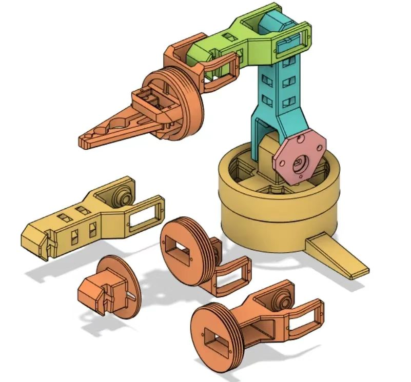
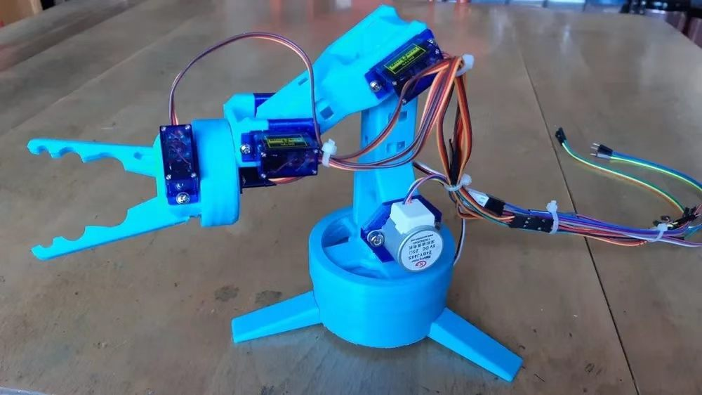

# 开源与第三方资料声明

> **队伍**：天山战队　｜　**实训战队**：陵龙战队　｜　**组别**：新生组
> **依据**：《CRTC2026 参赛手册》P10《文档规范》
> 「如果有使用开源项目用于机器人制作及代码编写的，应当在文档末尾完整说明。」

本队**未使用 GitHub/Gitee 上的开源代码项目**；机械抓夹的**爪架部分使用了一个来自 MakerWorld 平台的开源 3D 模型**，其余结构件为本队自行建模。以下逐项说明所有第三方来源。

---

## 一、代码

| 项 | 内容 | 性质 | 授权 |
|---|---|---|---|
| **HAL 库** | `STM32F1xx_HAL_Driver` | ST 官方提供，由 STM32CubeMX 自动生成 | ST 官方免费工具链（BSD-3-Clause 类） |
| **CMSIS** | `CMSIS/Device/ST/STM32F1xx`、`CMSIS/Core` | ARM / ST 官方提供 | Apache-2.0 |
| **启动文件** | `startup_stm32f103xb.s` | ST 官方模板 | 随 HAL 库 |
| **业务代码** | `main.c` / `drive.c` / `tools.c` / `ps2pad.c` / `cfg.h` 等 | **全部为本队自行编写** | 本队所有 |

### 明确声明

- **未复制任何第三方开源项目的业务代码。**
- 参考的**技术原理**（麦克纳姆轮运动学、SG90 舵机时序、PS2 手柄 SPI 类协议）来自**公开资料与培训讲义**，属通用工程常识，**未直接引用具体实现代码**。
- 代码中若出现与本队风格不一致的片段，均为 AI 辅助生成后**经本队上板验证**的产物，不含第三方版权内容。

---

## 二、机械模型

**本队在机械抓夹的爪架部分使用了一个来自 MakerWorld 平台的开源 3D 模型。以下如实说明其来源、处理方式与许可情况。**

### 2.1 爪架模型的来源与处理

| 项 | 内容 |
|---|---|
| **资源名称** | 机械夹爪 / 爪架 3D 模型 |
| **来源平台** | **MakerWorld** |
| **资源性质** | **平台上的开源共享 3D 模型资源** |
| **获取方式** | 在该平台检索夹爪类模型后下载模型文件 |
| **引入时间** | 2026-10-16 — 10-17（机构二次迭代阶段） |
| **处理方式** | **直接导入 3D 打印切片软件进行切片，并打印为实物装机。未对模型几何做修改。** |
| **切片参数** | 层高、填充率、支撑与打印方向由本队依 PLA/PETG 材料自行设定 |
| **实物后处理** | 去支撑、锉修倒角、扩孔（见 2.3）由本队完成 |

> **说明**：本节如实记录"下载 → 导入切片 → 打印 → 装机"这一完整链路。本队**未对该模型的几何结构做二次修改**，因此该模型的设计著作权归原作者，本队仅依其许可条款使用。

### 2.2 开源属性与许可说明

| 项 | 内容 |
|---|---|
| **开源属性** | 该模型在 **MakerWorld 平台以免费公开方式提供下载**（平台定位即 "free 3D models / stl models" 的开放社区），属社区共享的开源资源 |
| **许可证标注** | **该模型详情页未单独标注具体许可证类型，亦未显示作者署名信息** |
| **依据条款** | 依 MakerWorld 平台《用户协议》与《资源使用条款》，平台免费模型可用于个人非商业用途 |
| **本队遵守方式** | ① 在本文档中**完整披露来源平台、获取方式与处理流程**；② **仅用于 CRTC2026 比赛，属非商业用途**；③ **未声称该模型为本队原创**；④ 未将该模型用于转售、二次分发或任何商业目的 |
| **免责与后续** | 若原作者或平台后续提出授权要求（如补充署名、限制使用），本队愿依其要求执行；本队对该模型仅作打印与装车使用，未改动其几何结构 |

> **如实说明**：因该资源在下载时未见明确的许可证文本与作者署名，本队无法在文档中引用具体许可条款。此处选择**完整披露来源与用途**，而非引用一个无法核实的许可证名称——这比填一个可能是错的许可证更负责。

### 2.3 本队对爪架之外的改动

**爪架模型本身未改，但其装配相关处由本队做了适配：**

1. **舵机安装孔扩孔**——按本队 SG90 实测尺寸用钻头扩至可装入（FDM 打印收缩，孔径偏小）
2. **锉修连杆倒角**——消除两指张开极限位与连杆的干涉（见《开发日志》3.2）
3. **橡胶垫重贴**——夹爪内侧防滑橡胶垫由本队裁贴，第一次贴歪导致打滑，后重贴

### 2.4 其余结构件

| 部件 | 来源 |
|---|---|
| **臂部连杆、底座圈、顶板** | 由本队**潘美好**在 Fusion 360 中自行建模并打印 |
| **刘迎奥前期试建的部分零件** | 未形成可装配模型，**未并入最终整机** |
| **参考图（仅看图参考）** | 本队检索到的机械臂实物图与模型渲染图，见 2.5 |

### 2.5 参考图片的性质





除上述 MakerWorld 模型外，本队另检索过机械臂/夹爪的**实物图片与渲染图**作为外观参考（见下图）。

| 项 | 说明 |
|---|---|
| **资料性质** | 网络公开图片 |
| **用途** | **仅作外观与布局参考**——定"大概长什么样、几个关节、舵机装在哪" |
| **是否构成复制** | 否。未取得、未使用任何模型文件 |

## 三、学习资料

| 来源 | 内容 | 性质 | 使用方式 |
|---|---|---|---|
| **陵龙战队** | 机械培训、硬件及整车装配培训 | 实训战队统一培训 | 课堂听讲 + 课后提问 |
| **队内学长** | 电控培训（GPIO / PWM / 电机驱动 / 供电规范） | 队内培训 | 同上 |
| **B 站「keysking」** | 单片机入门系列 | 公开课（免费） | 观看学习，未复制代码 |
| **B 站「黑马程序员」** | C 语言课程 | 公开课（免费） | 观看学习（毛诗棋） |
| **ST 官方文档** | 数据手册、参考手册、HAL 库文档 | 官方文档 | 查阅 |

> **以上资料均用于学习，未直接复制其中的代码或模型用于交付物。**

---

## 四、AI 辅助工具

**如实声明**：本队在开发过程中使用了 AI 辅助工具（大语言模型），用于：

- 解读报错信息与排查方向建议
- 解释数据手册中的寄存器 / 时序概念
- 提供代码框架思路

**使用原则（本队自定规矩）**：

```
AI 给的东西一律上板验证，跑不通便不算数。
```

**本队所有交付代码均经实机编译、烧录、运行验证。** 文档中标注「验证过」的内容无一例外上过板；仅按建议配置而未自行验证的，未写成「学会了」。

---

## 五、图片素材

| 来源 | 内容 |
|---|---|
| **本队自行拍摄** | 实验室实拍、装配过程照、订单截图、白板示意图、实物特写 |
| **本队自行绘制** | 结构框图、接线示意图、迭代流程图 |

**未使用任何来自网络的版权图片作为文档插图。** 机构参考图如出现，均以题注标明其「网络公开图片，仅作参考」性质。

---

## 六、承诺

本队郑重承诺：

1. 提交的**业务代码全部为本队自行编写**，不存在抄袭、复制第三方开源项目的情况
2. 提交的**机械模型来源已完整披露**——爪架部分来自 **MakerWorld 平台的开源资源**，已按本文档第二节说明其获取、处理与使用方式；其余结构件为本队自行绘制。**本队未声称爪架模型为本队原创。**
3. 提交的**图片素材全部为本队自行拍摄或绘制**，不存在侵权情况
4. 使用的第三方组件（HAL 库、CMSIS 等）**均为官方免费工具链**，符合其授权条款
5. **如评审或原作者认为本文档对 MakerWorld 资源的说明仍有欠缺，本队愿立即补充署名或停止使用该模型。**
6. 如评审发现任何遗漏未声明的第三方来源，本队愿承担相应责任并即时补充

---

*天山战队　队长　毛诗棋　2026-10-19*
